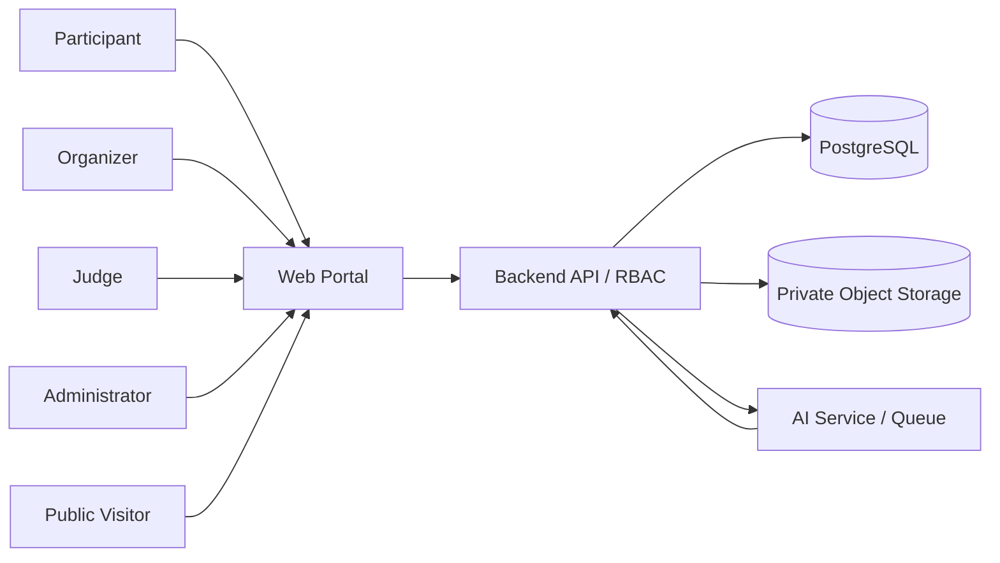

# CTX-01 — Context, actors, system boundary

## 1. Context được giảng viên cung cấp [G]
Cuộc thi nhiếp ảnh phim nhận ảnh scan từ người tham gia, yêu cầu metadata analog và đôi khi có chứng từ âm bản. Organizer điều hành; Judge chấm theo bộ tiêu chí; Admin quản trị; Participant nộp bài. AI cảnh báo trùng/AI-generated và gắn nhãn, hỗ trợ thống kê. Platform dự kiến Web và Mobile; sản phẩm bàn giao có “Web / Mobile” cho Participant.

## 2. Stakeholders và quyền chính

| Actor | Nhu cầu | Được phép | Cần ngăn |
|---|---|---|---|
| Administrator | Bảo trì hệ thống, user, danh mục, giám sát | Admin portal, master data, role | Tự ý đổi điểm giám khảo không lưu dấu |
| Contest Organizer | Lập cuộc thi, duyệt, phân công, công bố | Contest scope được giao | Truy cập contest không thuộc quyền |
| Judge | Chấm và nhận xét | Assigned submissions trong round | Xem bài không được phân công, công bố kết quả |
| Participant | Đăng ký, roll/frame, nộp, xem lịch sử | Dữ liệu cá nhân + contest public | Xem điểm chưa công bố, sửa bài người khác |
| Public Viewer [D] | Xem kết quả/triển lãm công khai | Archive được phát hành | Xem âm bản, dữ liệu riêng tư |
| AI Service [D] | Phân tích file theo job được cấp | Payload tối thiểu để dự đoán | Tự quyết định loại tác phẩm |

## 3. Context diagram (đề xuất)

## 4. Assumptions cần xác nhận
- **D-01:** Web responsive có đủ để đáp ứng phạm vi trước mắt hay giảng viên bắt buộc demo Flutter?
- **D-02:** Một Participant được nộp bao nhiêu ảnh mỗi hạng mục và có được nộp lặp sang contest khác?
- **D-03:** Enrollment tự động duyệt hay Organizer phải duyệt?
- **D-04:** Ngưỡng tối đa file, loại JPEG/TIFF, metadata bắt buộc theo contest rule?
- **D-05:** Số Judge/round và số vòng tối thiểu?
- **D-06:** Công thức tổng điểm, tie-break và điều kiện công bố?
- **D-07:** Negative/contact sheet có bắt buộc trong một số contest không?
- **D-08:** Thời hạn lưu ảnh, mức công khai/consent và quyền tác giả?

## 5. Boundary / out of scope đề xuất
Không xây mạng xã hội riêng, không xây film lab portal thanh toán, không huấn luyện AI detector từ đầu nếu không đủ dữ liệu, không bảo đảm phát hiện 100% gian lận hoặc quyền lưu trữ vô hạn. Bất kỳ hạng mục thuộc yêu cầu gốc nào muốn giảm scope phải hỏi giảng viên.

[Decision Log](../01-governance/open-questions.md) · [Feasibility](../06-feasibility/feasibility-study.md)
