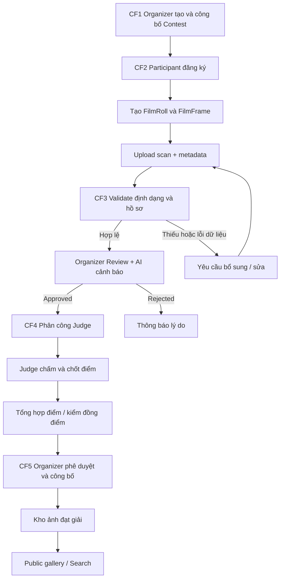

# FLOW-01 — 5 Core Flow và liên kết chức năng

> **Nguồn:** [G] mục c) 5 Business Core Flows; `[D]` quy trình trạng thái và Mermaid dưới đây giúp phân tích, chưa được giảng viên xác nhận là nghiệp vụ bắt buộc.

## 1. Bảng phân rã Core Flow

| Luồng | Đầu vào | Xử lý | Đầu ra | FR liên quan |
|---|---|---|---|---|
| CF-1: Lập kế hoạch/cấu hình | Organizer, thể lệ, thời gian, hạng mục | Tạo contest, criteria, awards | Contest PUBLISHED | FR-01, FR-03 |
| CF-2: Nộp bài & metadata | Enrollment, Roll, Frame, ảnh scan | Đăng ký, upload, gửi bài | Submission SUBMITTED | FR-04, FR-05, FR-06, FR-17 |
| CF-3: Thẩm định | Submission, rules, AI flags | Validation, review quyết định | Approved/Rejected/Revision | FR-07, FR-08, FR-13, FR-14 |
| CF-4: Chấm thi | Approved submission, assignment, criteria | Score draft, finalize, aggregate | Ranking draft | FR-09, FR-10, FR-11 |
| CF-5: Công bố/lưu trữ | Approved ranking, award | Publish, archive, gallery | Kết quả công khai / Digital Archive | FR-11, FR-12, FR-15, FR-16 |

## 2. End-to-end user journey

## 3. State machine đề xuất

**Contest:** `DRAFT → PUBLISHED → OPEN_FOR_SUBMISSION → CLOSED → JUDGING → RESULTS_PUBLISHED → ARCHIVED`. Các trạng thái cụ thể cần thống nhất với BE.

**Enrollment:** `PENDING → APPROVED / REJECTED`; nếu auto-approved có thể `APPROVED` ngay. Không trộn Enrollment với Submission.

**Submission:** `DRAFT → UPLOADING → SUBMITTED → VALIDATING → PENDING_REVIEW → APPROVED / REJECTED / NEEDS_CORRECTION`; từ NEEDS_CORRECTION chỉ trở lại SUBMITTED khi quy chế cho phép. Không chấm bài chưa APPROVED.

**ScoreSheet:** `DRAFT → FINALIZED`; mở lại `REOPENED → FINALIZED` cần quyết định có thẩm quyền và log. Không chỉnh thẳng bản final.

## 4. Cross-module failure, cần demo
1. Participant mở form trước deadline, bấm nộp sau deadline: server từ chối finalize, không cho chấm.
2. Bài upload tốt nhưng AI timeout: bài vẫn vào quy trình kiểm duyệt thủ công, gắn cờ AI pending.
3. Organizer duyệt cùng lúc trên hai thiết bị: một thao tác thắng, thao tác còn lại nhận `409 Conflict`.
4. Judge nộp điểm quá thang: BE 422, không tạo FINALIZED.
5. Tie-break chưa quyết định: hệ thống không công bố ngẫu nhiên.
6. Public visitor cố mở negative: 403/404, không được trả signed URL.

## 5. Dữ liệu chạy xuyên luồng
`User → Enrollment → FilmRoll → FilmFrame → MediaAsset → Submission → ValidationReport → ReviewDecision → JudgeAssignment → ScoreSheet → CriterionScore → RankingSnapshot → ArchiveEntry`.

[FR Index](../02-requirements/README.md) · [Entities](../03-domain/entities.md) · [E2E Test](../05-quality/e2e-test-cases.md)
