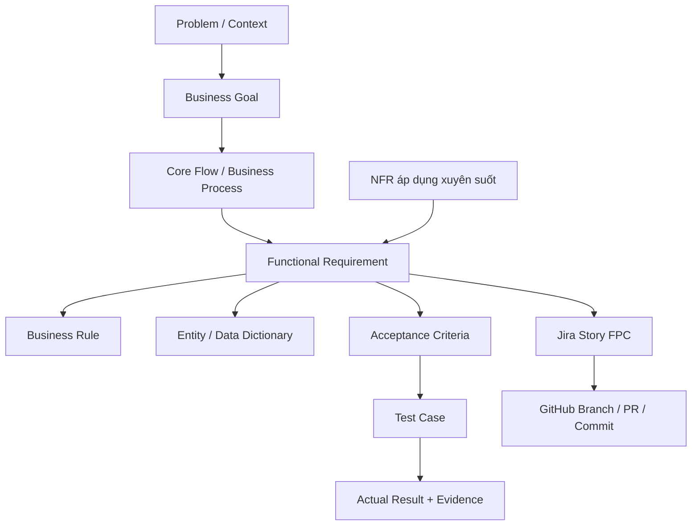

# REQM-01 — Requirements Management Plan

**Version:** 0.9 · **Owner:** TV1 (PM/BA) · **Review:** TV2 (tech), TV3 (Participant), TV4 (Organizer/Judge), TV5 (AI) · **Baseline:** CHƯA CHỐT.

## 1. Mục tiêu quản lý yêu cầu

Mỗi yêu cầu phải **duy nhất, cần thiết, rõ ràng, nhất quán, khả thi, kiểm chứng được, truy vết được và có người phụ trách**. Thầy có thể đi từ vấn đề → FR → Business Rule → Entity → Acceptance Criteria → Test → Jira Story → commit/PR/demo. Không dùng Jira thay thế tài liệu SRS.

## 2. Mô hình phân rã theo tầng



## 3. ID, version, trạng thái

| Artifact | Quy tắc ID | Nơi lưu | Ví dụ |
|---|---|---|---|
| Problem | PB-xx | `Docs/00-overview/` | PB-02 |
| Functional Requirement | FR-xx | `Docs/02-requirements/functional/` | FR-06 |
| Non-Functional Requirement | NFR-xx | `Docs/02-requirements/non-functional/` | NFR-01 |
| Business Rule | BR-xx | FR + `Docs/03-domain/business-rules.md` | BR-20 |
| Acceptance Criteria | AC-FR-xx-yy | Trong từng FR | AC-FR-06-03 |
| Test Case | TC-FR-xx-yy | Trong FR + Test Matrix | TC-FR-06-03 |
| Jira Story | Jira tự cấp key; FPC chỉ là mã kế hoạch | Jira | FPC-23 |
| Change request | CR-YYYY-NN | Decision/change log + Jira | CR-2026-01 |

`DRAFT → IN_REVIEW → APPROVED → IMPLEMENTED → VERIFIED` là trạng thái yêu cầu. Việc đã **được duyệt SRS** không đồng nghĩa code đã xong; `IMPLEMENTED` chưa có nghĩa `VERIFIED`.

## 4. Definition of Ready — yêu cầu được phép đưa vào Sprint code

- [ ] Mô tả mục tiêu/actor/input/output rõ ràng.
- [ ] Main Flow và Unhappy Case có thứ tự, không chỉ liệt kê tên chức năng.
- [ ] Rule `TBD` quan trọng đã được quyết định, hoặc Story chỉ làm spike nghiên cứu.
- [ ] Entity/FK/API contract sơ bộ đã review; tránh FE/BE hiểu khác nhau.
- [ ] AC có thể kiểm thử; có owner, estimate giờ và dependency.
- [ ] Không xung đột với nguồn G và đã được reviewer chéo.

## 5. Quy trình tạo hoặc chỉnh sửa requirement

1. **Tạo issue phân tích:** Đưa mã yêu cầu, nguồn, câu hỏi và owner lên Jira; không đưa code ngay khi BR chưa rõ.
2. **Viết nhánh docs:** `docs/FPC-xx-short-name` từ develop; tạo file/tăng version. Nếu thay đổi rule cũ, gắn mã CR.
3. **Peer review:** Reviewer đọc nguồn, tìm conflict, test Happy/Unhappy và kiểm Entity/công thức.
4. **Impact analysis:** So danh sách FR/NFR, Entity, migration, API, FE, AI, Test, Story và sprint deadline bị tác động.
5. **Phê duyệt:** TV1 thống nhất nghiệp vụ, TV2 chốt ảnh hưởng kỹ thuật; yêu cầu gốc hoặc cắt scope phải xin ý kiến GV.
6. **Merge PR:** Chỉ khi có approval và links không hỏng. Cập nhật requirement index/traceability/changelog.
7. **Thực thi:** Story code có link tới requirement, mỗi PR giải thích AC đáp ứng và cách test.
8. **Kiểm chứng:** Test ghi Expected/Actual và Evidence, chỉ chuyển VERIFIED khi hoàn tất.

## 6. Requirement Change Request (mẫu)

```markdown
### CR-YYYY-NN — <tên thay đổi>
- Requester / date:
- Requirement: FR-xx, BR-xx
- Lý do / nguồn quyết định:
- Hiện tại:
- Đề xuất mới:
- Phân tích ảnh hưởng: database / API / FE / AI / test / Jira / giờ công
- Rủi ro nếu thay đổi / nếu không thay đổi:
- Người phê duyệt / ngày:
- PR / link Jira:
```

## 7. Tiêu chí chất lượng và cách kiểm

| Tiêu chí | Kiểm bằng gì | Người chịu trách nhiệm |
|---|---|---|
| Completeness | Có actor, pre/post, happy/unhappy, AC, data, limits | Owner + TV1 |
| Consistency | FR khớp state/entity/API/BR | TV2 + module owner |
| Testability | Từ AC tạo TC, expected rõ | Owner + reviewer |
| Feasibility | Estimate giờ, PoC, fallback, constraint | TV1 + TV2 + TV5 |
| Traceability | FR↔FPC↔TC↔PR↔Evidence | TV1 |
| Governance | Review PR, version, change log | TV1 |

## 8. Bằng chứng bắt buộc khi thầy hỏi

Mở `Docs/02-requirements/README.md` → chọn FR-06 → trỏ mục 4/5/9/10 → `Docs/03-domain/entities.md` → `Docs/04-traceability/requirements-matrix.md` → Jira FPC-23 (nếu đã tạo) → PR/Test khi có. **Tuyệt đối không nói Pass khi mới viết Expected.**

[Open Questions](open-questions.md) · [Review Protocol](review-approval.md) · [Traceability](../04-traceability/requirements-matrix.md)

## V3 — Quy trình Business Exception Review và quy tắc phê duyệt

### A. Khi giảng viên đưa ra một tình huống mới

1. Ghi `Issue ID`, actor, trạng thái trước, dữ liệu liên quan, thời điểm, sự kiện lỗi.
2. Xác định đây là **thiếu requirement** (new/change) hay **defect code** (sai requirement được phê duyệt).
3. Tra [Decision Tables](../03-domain/business-decision-tables.md), [State Machines](../03-domain/state-transitions.md) và [Invariants](../03-domain/business-invariants.md). Nếu chưa có policy: tạo D-xx/TBD thay vì tự quyết.
4. Tính tác động trên FR/BR/Entity/API/FE/NFR/TC/Jira/hours/quality; cập nhật đúng các file bằng một PR có reviewer chéo.
5. Có test phản biện với Expected và **Actual** từ chạy thật khi có code; nếu chưa chạy, để `NOT RUN`.
6. Owner + reviewer xác nhận kết quả; quyết định business quan trọng cần giảng viên phê duyệt nếu nằm ngoài văn bản đề tài.

### B. Phân biệt thay đổi Requirements với sửa lỗi

| Loại | Ví dụ | Xử lý |
|---|---|---|
| Requirement gap | Chưa biết nếu hai bài đồng điểm thì giải nào | D-06, thảo luận với GV, sau đó bổ sung BR/AC/TC |
| Bug | Theo rule đã chốt, nộp sau hạn phải từ chối nhưng API vẫn chấp nhận | Jira Bug link FR-06, viết failing test, sửa BE, chạy regression |
| NFR shortfall | Upload hợp lệ nhưng quá chậm trong điều kiện mục tiêu | Xác nhận target tải; đo baseline; tối ưu/giảm scope có approval |
| External limitation | AI detector dự đoán sai | Chỉ flag + human review; trình bày precision/false positives, không hứa 100% |

### C. Gợi ý review gate trước buổi học

- TV1 (BA) xác nhận bối cảnh, mục tiêu, scope và business decisions.
- TV2 xác nhận entity, API/DB/storage/transactions, thời gian triển khai và exception handling.
- Owner FR xác nhận FE/BE flow và test scenario, một thành viên khác review chéo.
- Nhóm trưởng lưu biên bản quyết định, PR và issue Jira tương ứng.
