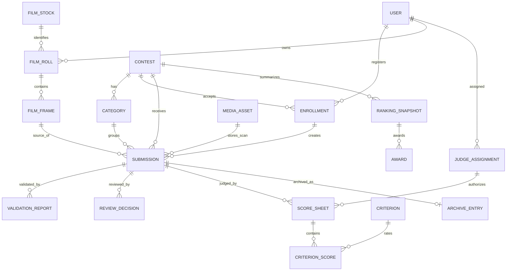

# ERD-01 — Sơ đồ quan hệ dữ liệu trọng tâm (ĐỀ XUẤT)

> Đây là **conceptual ERD rút gọn** để thầy xem quan hệ logic. Các entity phụ như Prize, Role, MediaTag, Notification, AuditLog, AIAnalysis được giải thích đầy đủ tại [Entity Catalogue](entities.md). Không thay thế migration PostgreSQL thật.

## Năm truy vấn/ràng buộc cần chứng minh khi demo

1. Từ `submission_id` truy ra đúng film roll, frame number, loại phim, lab, scan file.
2. Mỗi Submission thuộc Contest/Category/Enrollment đồng nhất.
3. Chỉ JudgeAssignment hợp lệ mới sinh ScoreSheet cho bài Approved.
4. RankingSnapshot tổng hợp từ ScoreSheet FINALIZED với criterion version.
5. ArchiveEntry chỉ tham chiếu Submission có award đã công bố.

## Quyết định chưa chốt

Cardinality cho Frame→Submission và Asset→Submission phụ thuộc D-02. Minh chứng âm bản cần MediaAsset phụ theo loại chứng từ; không tự mặc định public. Cơ chế hỗ trợ đa vòng có thể cần thêm khóa round/category ở một số bảng.
