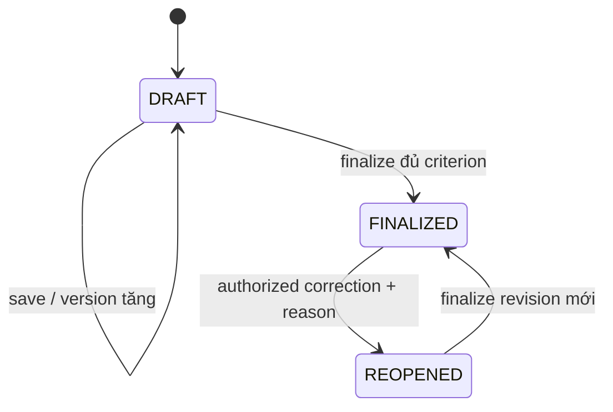
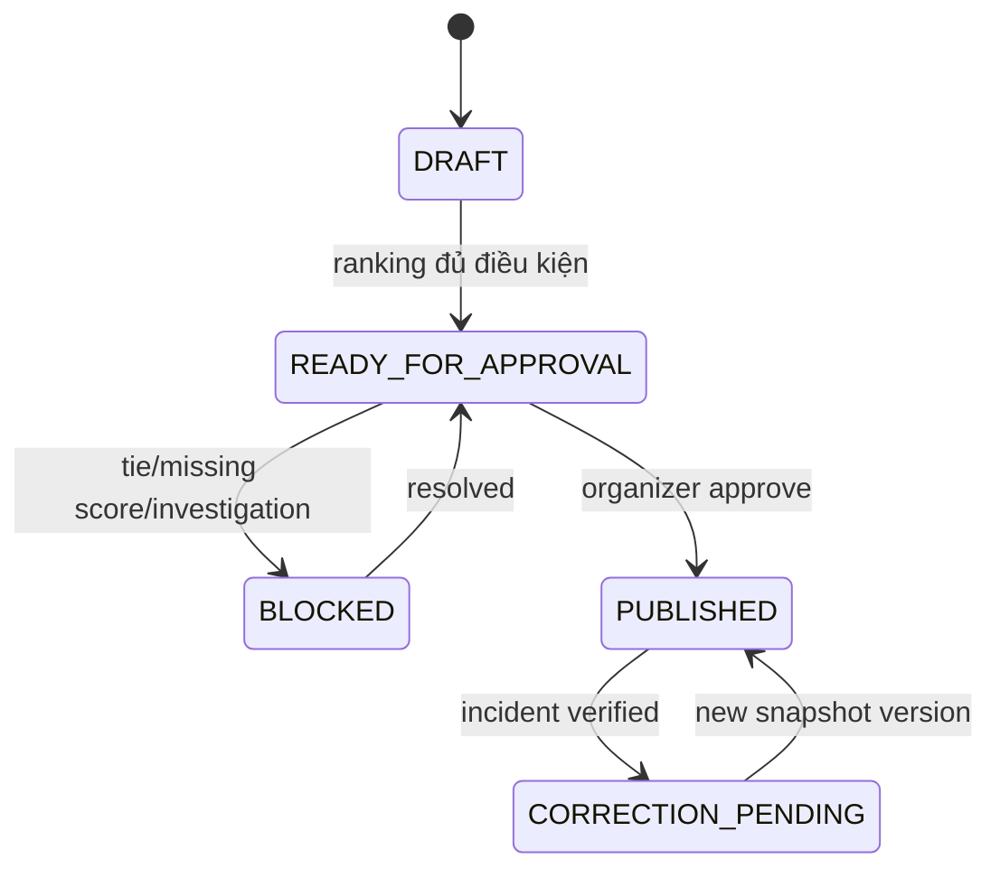

# STATE-01 — State Machines / Quy trình chuyển trạng thái

> **DRAFT [D]** — mô hình đề xuất. Không đồng nhất trạng thái Enrollment, Submission, ScoreSheet và Publication. Nếu thầy thay đổi quy tắc, phải sửa đồng thời code, transition guard, test và tài liệu.

## 1. Nguyên tắc

1. **Mỗi entity chỉ có một lifecycle thuộc trách nhiệm của nó.** Submission không sử dụng `FINALIZED` của ScoreSheet.
2. Trạng thái chỉ đổi bởi **Backend sau khi kiểm tra guard**, không phải do UI gửi tùy ý.
3. Mỗi chuyển trạng thái quan trọng có `actor_id`, `occurred_at` UTC, `old_status`, `new_status`, `reason` (nếu yêu cầu), `version` và `event_id` để audit.
4. Lỗi transaction phải giữ nguyên trạng thái hiệu lực; retry cùng yêu cầu không được làm nhân đôi hậu quả.

## 2. Submission state machine (FR-06/07/08)

```mermaid
stateDiagram-v2
    [*] --> DRAFT
    DRAFT --> SUBMITTED: finalize trước deadline
    SUBMITTED --> VALIDATING: bắt đầu kiểm tra
    VALIDATING --> PENDING_REVIEW: kiểm tra hoàn tất
    VALIDATING --> PENDING_REVIEW: AI chưa sẵn sàng; vẫn kiểm tra thủ công
    PENDING_REVIEW --> APPROVED: organizer approve
    PENDING_REVIEW --> REJECTED: organizer reject
    PENDING_REVIEW --> REVISION_REQUIRED: request revision
    REVISION_REQUIRED --> SUBMITTED: resubmit theo chính sách
    APPROVED --> UNDER_INVESTIGATION: cảnh báo hậu kiểm + người có quyền
    UNDER_INVESTIGATION --> APPROVED: khôi phục duyệt
    UNDER_INVESTIGATION --> REJECTED: thu hồi theo quy trình
```

**Giải thích:** `DRAFT` có thể là bản ghi nháp riêng; file upload tạm không được coi là bài nộp. `VALIDATING` chậm không tự động biến thành `REJECTED`. Điểm số và giải thưởng không nằm trong enum Submission. Khi bài đang `UNDER_INVESTIGATION`, các flow phân công/chấm/công bố phải chặn hoặc xử lý theo quyết định D-16.

| Transition | Ai kích hoạt | Guard bắt buộc | Dữ liệu ghi thêm | Trường hợp từ chối |
|---|---|---|---|---|
| DRAFT→SUBMITTED | Participant | JWT/owner, enrollment, deadline, file READY, quota | submitted_at từ server; metadata snapshot | quá hạn/asset lỗi/không owner |
| SUBMITTED→VALIDATING | Worker | đúng version, chưa process | job_id, started_at | job duplicate → idempotent |
| VALIDATING→PENDING_REVIEW | Worker | có ValidationReport; không còn bước chặn bắt buộc | rule_version, findings | lỗi worker → retry queue, không tự duyệt |
| PENDING_REVIEW→APPROVED | Organizer | quyền contest, rule thủ công, review version | ReviewDecision + audit | version conflict → 409 |
| PENDING_REVIEW→REVISION_REQUIRED | Organizer | có lý do và deadline theo rule | reason, revision_due | vượt quyền, thiếu reason |
| REVISION_REQUIRED→SUBMITTED | Participant | theo D-13; không vi phạm deadline/phiên bản | snapshot mới, revision version | quá hạn/không cho sửa |
| APPROVED→UNDER_INVESTIGATION | Organizer | nghi vấn có căn cứ, được cấp quyền | incident ID, reason, evidence | không có lý do/đã final công bố: dùng correction workflow |
| UNDER_INVESTIGATION→REJECTED | Organizer/phê duyệt | bằng chứng và policy duyệt lại | quyết định mới, downstream event | thiếu approval, dữ liệu xung đột |

## 3. ScoreSheet state machine (FR-10)

`FINALIZED` không được sửa bằng API update bình thường. Các lần reopen phải giữ lịch sử: ScoreSheetRevision hoặc append-only AuditLog + score version. Version concurrency chặn ghi đè từ tab cũ.

## 4. ResultPublication state machine (FR-11)

Bản snapshot cũ **không bị overwrite**. `PUBLISHED` là phiên bản công khai hiện hành, số version mới thay thế old active snapshot. Không thay Award/Archive bằng side-effect nửa thành công.

## 5. Enrollment/AIJob/Notification (phân biệt độc lập)

| Entity | Trạng thái tối thiểu (đề xuất) | Nguyên tắc |
|---|---|---|
| Enrollment | REQUESTED / APPROVED / REJECTED / CANCELLED | Cần chốt D-03 về auto approve; enrollment cancellation không xóa submission ngầm |
| AIJob | QUEUED / RUNNING / SUCCEEDED / FAILED_RETRYABLE / UNAVAILABLE | AI unavailable không đồng nghĩa submission invalid |
| Notification | PENDING / SENT / FAILED_RETRYABLE | Notification không quyết định trạng thái nghiệp vụ |

## 6. Các transition bị cấm và test đặc thù

| TC ID | Đầu vào | Expected |
|---|---|---|
| TC-STATE-01 | Participant tự gọi PATCH `APPROVED` | 403/409; không đổi trạng thái |
| TC-STATE-02 | Judge chấm Submission `REJECTED` | 409/403; không tạo score |
| TC-STATE-03 | Sửa ScoreSheet `FINALIZED` bằng save-draft | 409; không sửa |
| TC-STATE-04 | Công bố kết quả khi một bài `UNDER_INVESTIGATION` | Chặn / exclude theo quyết định; không công bố sai |
| TC-STATE-05 | Retry transition cùng event_id | Không nhân đôi quyết định hoặc notification |
| TC-STATE-06 | Revision sau deadline chưa có ngoại lệ | Từ chối, giữ lịch sử |

Liên kết: [Entity](entities.md) · [Decision Tables](business-decision-tables.md) · [Failure Recovery](../05-quality/failure-recovery-matrix.md).
